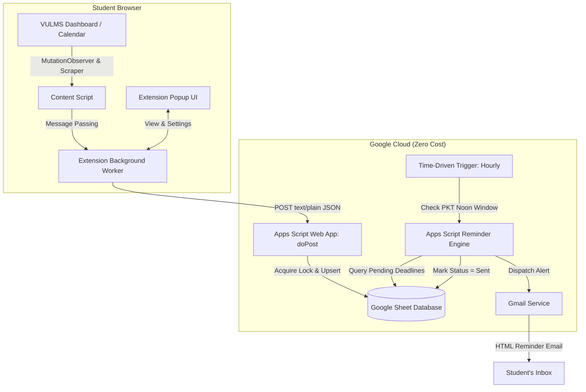

# VULMS Smart Deadline Tracker — Master Implementation Plan

## 1. Project Overview & Architecture

The **VULMS Smart Deadline Tracker** is a zero-cost, automated system designed for Virtual University of Pakistan students to track deadlines from their VULMS To-Do Calendar and receive email reminders at **12:00 PM (noon) Pakistan Standard Time (PKT)** on the due date.

### System Components:
1. **Chrome Extension (Manifest V3)**:
   - Scrapes authenticated student ID & To-Do Calendar items on login / page load.
   - Deduplicates locally and pushes delta changes to Google Apps Script.
   - Modern popup interface showing status, counters, logs, and manual sync.
2. **Google Apps Script Web App**:
   - Secure REST endpoint accepting synchronization payloads.
   - Concurrency locking with `LockService` to prevent race condition duplicates.
   - Upserts records into Google Sheets database.
3. **Google Sheets Database**:
   - Tabular persistent storage with normalized columns, date formats, and status flags.
4. **Google Apps Script Time-Driven Trigger Engine**:
   - Runs independently in Google Cloud (student's PC can be shut down).
   - Hourly checking engine targeting 12:00 PM PKT delivery.
   - Sends HTML reminder emails via Gmail API.



---

## 2. Phased Implementation Roadmap

### Phase 1: Data Modeling & Schema Design
* **Goal**: Establish the contract between the extension, Google Sheets, and the reminder engine.
* **Deliverables**:
  - Normalized date handling (`YYYY-MM-DD` in `Asia/Karachi`).
  - Deterministic unique composite key:
    $$\text{activity\_key} = \text{hash}(\text{student\_id} + \text{"\_"} + \text{course\_code} + \text{"\_"} + \text{activity\_type} + \text{"\_"} + \text{activity\_title})$$
  - Complete Google Sheet headers (`student_id`, `activity_key`, `course_code`, `activity_title`, `activity_type`, `start_date`, `end_date`, `status`, `reminder_status`, `reminder_sent_at`, etc.).

---

### Phase 2: Google Apps Script Backend & Database Logic
* **Goal**: Build the serverless backend inside Google Apps Script (`Code.gs`).
* **Deliverables**:
  - `doPost(e)`: Entry point handling text payload with `JSON.parse()`.
  - `syncActivities(payload)`:
    - Verifies student token / secret.
    - Locks execution via `LockService.getScriptLock()` (30s timeout).
    - Checks for existing keys: inserts new rows, updates changed rows (deadline/title), skips unchanged.
  - `checkAndSendReminders()`:
    - Filters rows where `reminder_status === "pending"`.
    - Evaluates if current PKT date $\ge$ `end_date` and PKT hour $\ge 12$.
    - Sends rich HTML formatted email.
    - Sets `reminder_status = "sent"` and timestamps `reminder_sent_at`.
  - `setupTriggers()`: Programmatic installation of hourly time-based triggers.
  - `testHarness()`: Pre-configured test suite for simulated synchronization runs.

---

### Phase 3: Chrome Extension Manifest V3 Core
* **Goal**: Build the browser client that observes VULMS without degrading performance.
* **Deliverables**:
  - `manifest.json`: Manifest V3 configuration with appropriate permissions (`storage`, `alarms`, host permissions for `*.vu.edu.pk` and `script.google.com`).
  - `content.js`:
    - Checks login state and extracts logged-in student ID from profile badge.
    - Multi-selector fallback scraper targeting To-Do Calendar tables, cards, and modal items.
    - MutationObserver to wait for asynchronous calendar DOM rendering.
    - Filters out invalid/dummy data.
  - `background.js`:
    - Manages sync queue and communicates with the Google Apps Script Web App.
    - Retries on network failure with exponential backoff.
    - Emits badges (`OK`, `SYNC`, `ERR`) on the extension icon.
  - `popup.html` & `popup.js`:
    - Modern glassmorphism UI.
    - Displays: Connection status, Student ID, Last Synced, Items Pending, Next Reminder.
    - "Sync Now" trigger button.
    - Settings modal for Web App URL and Personal Passphrase.

---

### Phase 4: Edge Cases & Business Logic Handling
* **Goal**: Ensure zero false reminders and proper handling of VULMS nuances.
* **Deliverables**:
  - **Grace Period / 24-hr Extended Day**: Detect revised deadlines and update `end_date` and reschedule reminder if deadline extended.
  - **Late Discovered Activities**: If first found after the end date, flag as `overdue` / `skipped` instead of scheduling a misleading reminder.
  - **Cancellation Detection**: Mark items deleted or cancelled on VULMS as `cancelled`.

---

### Phase 5: Verification Against All Acceptance Tests (A through J)
* **Test A**: First-time extraction produces exactly 1 row.
* **Test B**: 5x repeated extraction produces 0 duplicate rows.
* **Test C**: Activity discovered days in advance triggers at 12:00 PM PKT on end date.
* **Test D**: Rescheduled end date updates row and adjusts pending reminder.
* **Test E**: Repeated trigger runs never duplicate emails for the same item.
* **Test F**: Trigger runs successfully when user machine is offline.
* **Test G**: Scraper failure or empty calendar preserves existing records safely.
* **Test H**: Multi-student accounts keep data strictly isolated.
* **Test I**: Timezone calculations locked to `Asia/Karachi`.
* **Test J**: Late discovery receives no fake reminders.

---

### Phase 6: Distribution & Friend Onboarding Guide
* **Goal**: Make onboarding painless for non-technical fellow students.
* **Deliverables**:
  - **1-Click Google Sheet Template**: Copyable link with Apps Script embedded.
  - Step-by-step installation instructions for loading unpacked extension in Chrome.
  - Troubleshooting FAQ (dealing with Google OAuth warning screen, token reset, etc.).

---

## 3. Directory Structure to be Built

```text
vulms-tracker/
├── extension/
│   ├── manifest.json
│   ├── icons/
│   │   ├── icon16.png
│   │   ├── icon48.png
│   │   └── icon128.png
│   ├── content/
│   │   ├── content.js          # Scrapes VULMS DOM & observes dynamic loading
│   │   └── extractor.js        # Parsing & normalization rules
│   ├── background/
│   │   └── service_worker.js   # API communicator & background manager
│   └── popup/
│       ├── popup.html          # Clean dashboard & settings
│       ├── popup.css           # Modern styles
│       └── popup.js            # Popup interaction logic
├── apps-script/
│   ├── Code.js                 # Web App receiver & reminder scheduler
│   ├── EmailTemplate.html      # Responsive HTML reminder email
│   └── appsscript.json         # Apps Script manifest (Asia/Karachi timezone)
├── docs/
│   ├── SETUP_GUIDE.md          # 5-minute setup instructions for friends
│   └── TROUBLESHOOTING.md      # Common errors and fixes
├── PLAN.md                     # This plan
└── FIXES.md                    # Detailed fixes for gaps in initial requirements
```
