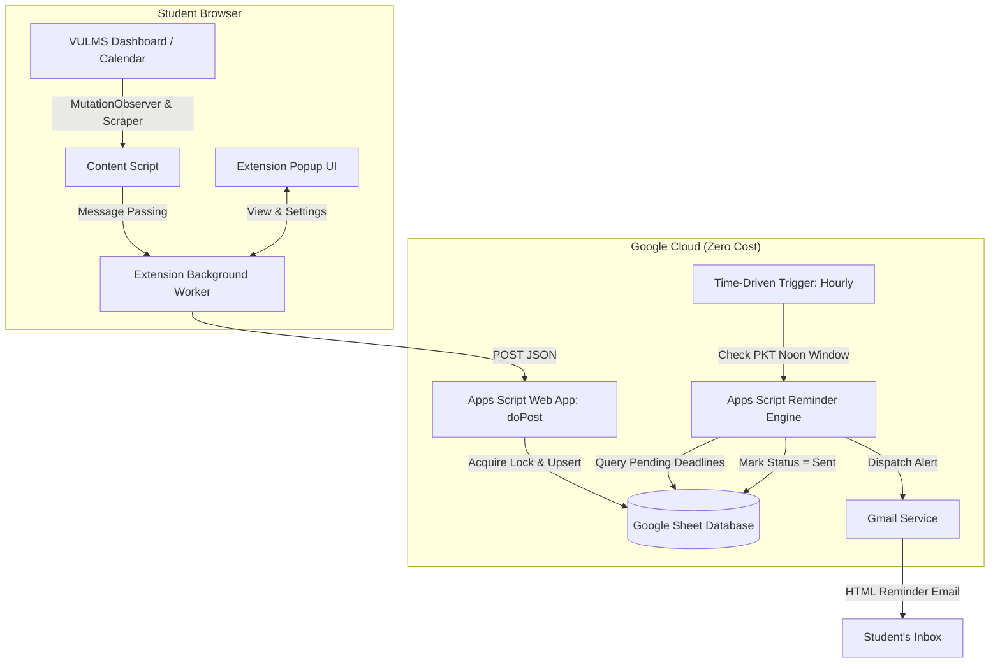

# 🎓 VULMS Smart Deadline Tracker

[](https://developer.chrome.com/docs/extensions/mv3/intro/)
[](https://developers.google.com/apps-script)
[](https://sheets.google.com)
[-blue)](https://time.is/PKT)

A zero-maintenance, 100% free automated tracking and notification system designed for **Virtual University of Pakistan (VULMS)** students. It automatically captures assignments, quizzes, and GDB deadlines from the VULMS To-Do Calendar, synchronizes them to a private Google Sheet database, and dispatches automated email reminders to your inbox at **12:00 PM (noon) PKT** on the deadline day.

---

## 🌟 Key Highlights

- **🤖 Zero-Friction Automation**: Silently extracts pending deadlines whenever you log in or visit your VULMS To-Do Calendar.
- **☁️ Cloud-Powered Reminders**: Built on Google Apps Script and Google Cloud triggers. Your computer does **not** need to stay turned on for reminders to fire.
- **🔒 100% Private & Free**: All data is stored in your personal Google Sheet and processed inside your personal Google Account. No third-party servers or subscriptions.
- **✨ Clean Popup Interface**: Inspect active deadlines, sync status, and trigger on-demand sync directly from the Chrome toolbar.
- **🛡️ Concurrency & Deduplication**: Employs deterministic composite keys (`activity_key`) and Google Apps Script `LockService` to prevent duplicate records or spam alerts.

---

## 🏗️ Architecture & Workflow



---

## 📁 Repository Structure

```text
├── apps-script/
│   ├── appsscript.json          # Manifest with Asia/Karachi timezone
│   ├── Code.js                  # Apps Script Web App (doPost, upsert, hourly trigger)
│   └── EmailTemplate.html       # Responsive HTML email notification template
├── docs/
│   ├── SETUP_GUIDE.md           # 5-minute step-by-step student setup guide
│   ├── SPREADSHEET_TEMPLATE.md  # Schema definitions, column formatting, and formulas
│   └── TROUBLESHOOTING.md       # Debugging checklist and FAQ
├── extension/
│   ├── manifest.json            # Chrome Extension Manifest V3 configuration
│   ├── background/
│   │   └── service_worker.js    # Background sync coordinator & alarm scheduler
│   ├── content/
│   │   ├── extractor.js         # DOM parser for VULMS To-Do calendar & student ID
│   │   └── content.js           # Injection lifecycle and message dispatcher
│   ├── popup/
│   │   ├── popup.html           # Toolbar popup dashboard
│   │   ├── popup.css            # Modern dark-mode styling
│   │   └── popup.js             # UI controls, test dispatch, and storage bindings
│   └── icons/                   # Extension icons (16, 48, 128)
└── tests/
    ├── mock_vulms_data.json     # Sample payload fixtures
    └── test_suite.js            # Node / browser compatibility test suite
```

---

## 🚀 Quick Setup (Under 5 Minutes)

For detailed step-by-step instructions with screenshots and troubleshooting, read the full **[Setup Guide](docs/SETUP_GUIDE.md)**.

1. **Set Up Google Sheet**:
   - Create a new Google Sheet and open **Extensions > Apps Script**.
   - Copy [`apps-script/Code.js`](apps-script/Code.js) and [`apps-script/EmailTemplate.html`](apps-script/EmailTemplate.html).
   - Ensure the timezone is set to `Asia/Karachi` using [`apps-script/appsscript.json`](apps-script/appsscript.json).
   - Refresh the sheet and click **🚀 VULMS Tracker > 1. ⚡ Activate 12:00 PM Cloud Scheduler** to authorize.
2. **Deploy Web App**:
   - In Apps Script, click **Deploy > New deployment > Web app**.
   - Set *Who has access* to **Anyone**. Copy the generated Web App URL.
3. **Load Chrome Extension**:
   - Open Chrome and navigate to `chrome://extensions/`.
   - Enable **Developer mode** (top right).
   - Click **Load unpacked** and select the [`extension/`](extension/) directory.
   - Click the extension icon in your browser bar, paste your Web App URL, and save!

---

## 🧪 Testing

Run the included test suite to verify extractor parsing and schema validation:

```bash
node tests/test_suite.js
```

---

## 📄 License

Distributed under the MIT License. Built for Virtual University students with ❤️.
