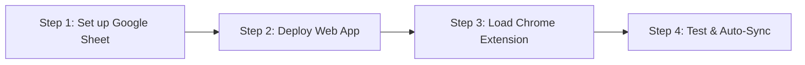

# 🚀 VULMS Smart Deadline Tracker — 5-Minute Student Setup Guide

Welcome! This system automatically tracks your assignments, quizzes, and GDBs from your Virtual University (VULMS) To-Do list and sends an email reminder to your Gmail inbox at **12:00 PM (noon) PKT on the day of the deadline**.

It is **100% free**, runs independently in Google Cloud (your computer does **not** need to stay on), and keeps your data strictly private to your own Google account.

---

## 📋 Overview of Setup

Total setup time: **under 5 minutes**.

---

## Step 1: Set up Your Private Google Sheet & Apps Script

1. Open [Google Sheets](https://sheets.new) to create a new spreadsheet.
2. Rename the spreadsheet to: **VULMS Deadline Tracker**.
3. In the top menu, click **Extensions** &gt; **Apps Script**.
4. In the Apps Script code editor:
   - Delete any default code inside `Code.gs`.
   - Copy the entire contents of [`apps-script/Code.js`](file:///apps-script/Code.js) and paste it into `Code.gs`.
   - Click the **+** (Add a file) icon next to *Files*, choose **HTML**, name it `EmailTemplate`, and paste the contents of [`apps-script/EmailTemplate.html`](file:///apps-script/EmailTemplate.html).
   - In the left sidebar, click the **Project Settings** (gear icon) &gt; check the box **"Show appsscript.json manifest file in editor"**.
   - Return to the Editor, open `appsscript.json`, and replace its content with [`apps-script/appsscript.json`](file:///apps-script/appsscript.json) (this ensures your timezone is locked to `Asia/Karachi`).
   - Click the **Save** (disk icon) or press `Ctrl + S`.
5. Now return to your Google Sheet tab and **refresh the page**.
6. You will see a new menu item in the toolbar: **🚀 VULMS Tracker**.
7. Click **🚀 VULMS Tracker** &gt; **1. ⚡ Activate 12:00 PM Cloud Scheduler**.
   - *Google will prompt you to authorize permissions:*
   - Click **Continue**.
   - Choose your Google account.
   - Click **Advanced** (at the bottom of the prompt), then click **Go to Untitled project (unsafe)**. *(This is normal for personal custom scripts you own)*.
   - Click **Allow**.
   - You will see a confirmation popup: `12:00 PM Scheduler Activated!`.

---

## Step 2: Deploy as a Web App

1. In your Apps Script editor, click the blue **Deploy** button (top right) &gt; **New deployment**.
2. Click the gear icon next to "Select type" and choose **Web app**.
3. Fill in the deployment form:
   - **Description**: `VULMS Tracker v1`
   - **Execute as**: `Me (your_email@gmail.com)`
   - **Who has access**: `Anyone` *(Crucial: allows your Chrome extension to send payloads without OAuth complexity)*
4. Click **Deploy**.
5. Copy the generated **Web app URL** (it looks like `https://script.google.com/macros/s/AKfycbx.../exec`).

---

## Step 3: Load the Chrome Extension

1. Open Google Chrome and go to `chrome://extensions/`.
2. In the top-right corner, turn ON **Developer mode**.
3. Click the **Load unpacked** button (top left).
4. Select the `extension/` directory from this project folder.
5. The **VULMS Smart Deadline Tracker** icon will now appear in your browser toolbar! Pin it for easy access.

---

## Step 4: Connect & Test

1. Click the **VULMS Tracker** icon in your Chrome toolbar.
2. In the popup, click the **⚙️ (Settings)** icon.
3. Paste the **Web app URL** you copied in Step 2.
4. *(Optional)* Enter your name in **Student Display Name**.
5. Click **Test Connection**:
   - You should see: `✅ Connection Successful!`.
6. Click **Send Test Email**:
   - Open your Gmail inbox — you will have received a sample VULMS alert email!
7. Click **Save Settings**.

---

## Step 5: Start Using VULMS

1. Open your browser and log in to [VULMS](https://vulms.vu.edu.pk).
2. Go to your **Home** or **Student Dashboard** / **To-Do Calendar**.
3. The extension will automatically detect your Student ID, extract your active assignments, quizzes, and GDBs, and sync them to your Google Sheet!
4. A small green toast notification will appear in the bottom-right corner confirming the sync.
5. You can now close your browser, turn off your computer, or go about your day.
6. Whenever an activity reaches its deadline date, Google Cloud will automatically send you an email at **12:00 PM noon PKT** with the exact submission details and link!

---

## 🎉 You're All Set!

- **Want to force an immediate refresh?** Open your VULMS tab and click the **Sync Now** button in the extension popup.
- **Want to inspect your records?** Click **View Sheet** in the popup to see all current and past activities in your Google Sheet database.
